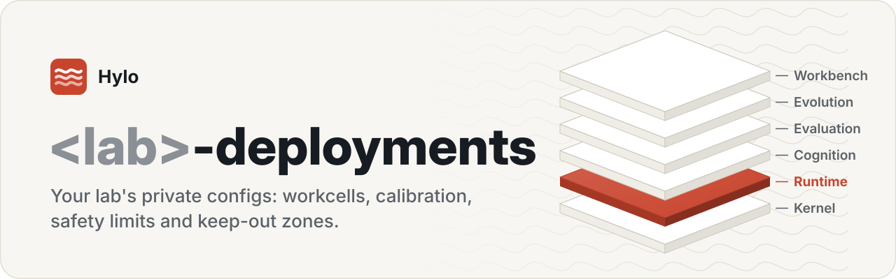
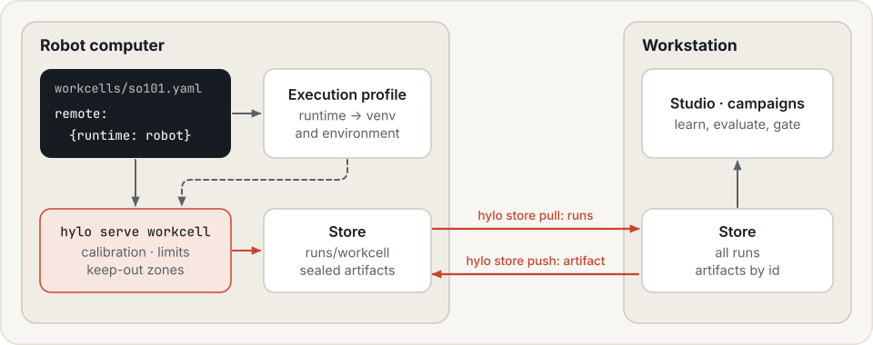
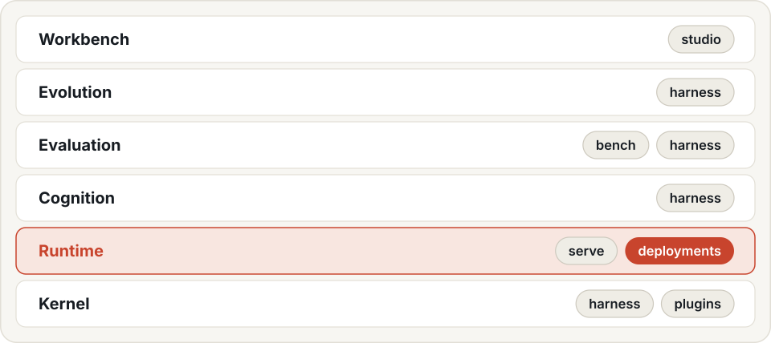

<p align="center">
  <picture>
    <source media="(prefers-color-scheme: dark)" srcset=".github/assets/banner-dark.svg">
    -deployments (template): your lab's private configs: workcells, calibration, safety limits and keep-out zones">
  </picture>
</p>

<p align="center">
  <a href="LICENSE"></a>
  
  
  
</p>

<p align="center">
  <a href="https://hyloai.github.io/"><b>Website</b></a> ·
  <a href="https://hyloai.github.io/hylo-docs/"><b>Docs</b></a> ·
  <a href="https://hyloai.github.io/hylo-docs/getting-started/quickstart/"><b>Quickstart</b></a> ·
  <a href="https://github.com/HyloAI"><b>All repositories</b></a>
</p>

Part of [Hylo](https://hyloai.github.io/), the stack for physical AI: configuration for the **runtime** layer.

Template for a lab's own, private repository of what runs on its robots: one workcell config per robot or
simulator, with its calibration, safety limits and keep-out zones, and how it reaches its policy server. It holds
configuration only; components are named by what the Hylo repositories register.

To deploy a robot-skill implementation developed elsewhere, record the intended agent or campaign version, pinned artifact references,
required runtime packages and robot calibration in the deployment configuration. Verify compatibility and safety
on the target workcell before use. Development sessions and their raw outputs belong in the experiment store;
this repository holds the configuration needed to run the selected version.

See [Robot skills and their lifecycle](https://hyloai.github.io/hylo-docs/user-guide/skills/) for how deployment
configuration relates to development, verification and reusable program-skill records.

| File | Workcell |
|---|---|
| `workcells/sim_arm.yaml` | a simulated arm (no hardware): bring-up and operator flow |
| `workcells/so101.yaml` | an SO-101 arm through LeRobot's Robot interface |
| `workcells/libero10_sim.yaml` | LIBERO-10 in simulation, with the robot-side runtime |

```bash
hylo serve workcell --config workcells/sim_arm.yaml --port 8102
hylo serve workcell --config workcells/so101.yaml --host 0.0.0.0 --port 8100 --token $HYLO_TOKEN
```

<p align="center">
  <picture>
    <source media="(prefers-color-scheme: dark)" srcset=".github/assets/sync-dark.svg">
    
  </picture>
</p>

Configs name runtimes (`remote: {runtime: robot}`), never paths: each machine's execution profile says where the
runtime's venv is and which environment variables it needs (`hylo profile set-runtime robot --python ... --env ...`;
bench's LIBERO setup registers `libero-sim` and `lerobot`). Keep tokens out of the repository (environment
variables).

Episodes recorded on the robot computer reach the workstation through the store (RFC-0005): register the
directory the workcell writes to (`hylo store init runs` on the robot, where `output_dir: runs/workcell` lands), then
on the workstation `hylo store pull robot-host:/path/to/runs` copies the runs it does not have yet, and
`hylo store push robot-host:/path/to/runs artifact:<name>@<digest>` sends an artifact (a judge, a memory) the
other way. Sealed artifacts are never overwritten; the same path holding different content is a conflict.

Documentation (hylo-docs, `uv run mkdocs serve -f docs/mkdocs.yml` from the workspace): [deployments repository](../docs/docs/configuration/deployments-repo.md), [deployment](../docs/docs/user-guide/deployment.md).

## The Hylo stack

<p align="center">
  <picture>
    <source media="(prefers-color-scheme: dark)" srcset=".github/assets/stack-dark.svg">
    
  </picture>
</p>

## License

Apache License 2.0 (see [LICENSE](LICENSE)). Copyright 2026 Hylo AI.
